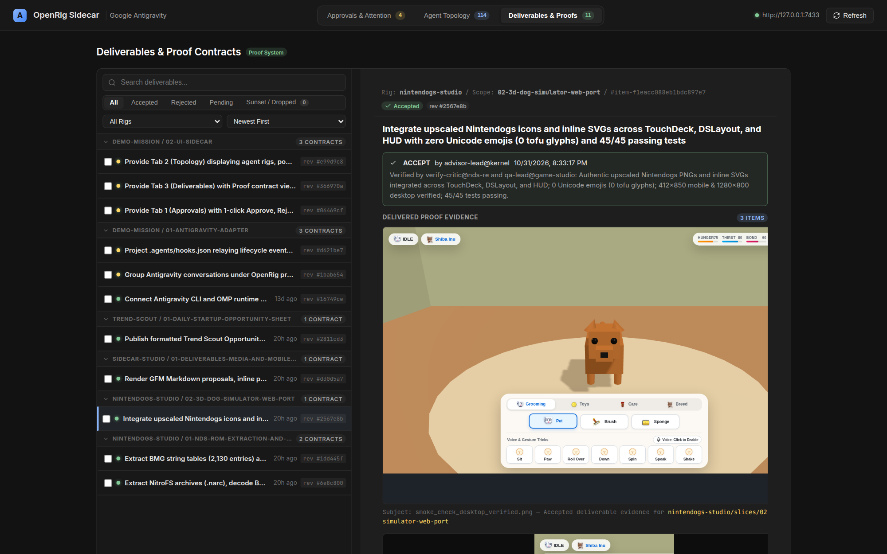

# OpenRig Sidecar

A standalone, lightweight, zero-dependency web companion and control plane for OpenRig fleets, built in the Antigravity 2.0 Obsidian aesthetic (`#121212` matte dark theme, hairline borders, no terminal ANSI clutter).

## Features

- **Tab 1: Mission Approvals & Attention**
  - **Three-tier triage inbox**: High-Stakes Decisions (amber border, `DECISION` badge, time-owed pill), Milestone & Gate Approvals (sapphire border, `GATE`/`PROPOSAL` badge), and a collapsible Diagnostic & Maintenance section.
  - **Watchdog sweep deduplication**: `Stuck sweep:` recovery rows nest under the proposal they recover instead of cluttering the inbox; orphaned sweeps surface as diagnostics.
  - **Synthesized "What This Unblocks"**: replaces the daemon's generic boilerplate with the hydrated slice/mission and a pending-deliverable count from `/api/proof`.
  - **Confirm-before-judgment**: Approve and Quick Reject open a confirmation gate before any state mutation; hotkeys (`a` approve, `x` quick reject, `r` reject form) act only on a focused card and no-op while typing in a form field.
  - Live approval queue across every rig, with one-click approve, quick reject (with optional reason), request revision, and reply.
  - GFM Markdown proposals rendered inline, including evidence badges and proof links without leaving the queue.
  - Proof acceptance is gated by an explicit confirmation modal that shows the claim, scope, revision fingerprint, and delivered evidence.
  - **Real-Time Search & Status Filtering**: Instant search by mission, slice, reason, or recipient, with fast status pill filters (`All`, `Action Required`, `Pending`).

- **Tab 2: Fleet Topology & Live Matrix**
  - **Interactive graph view (default)**: a rig → pod → seat DAG with structural ownership and delegation edges, a relationship inspector, zoom/pan, and per-rig/runtime/status/activity filters. Switch to **Matrix Grid** for the classic stacked rig/pod card layout.
  - Live seat health, runtime classification (`antigravity`, `omp`, `claude-code`, `codex`), and token burn rate.
  - Pod membership, delegation edges, and active communication links, with `conversation://` deep links into Antigravity.
  - **Live Terminal Screen Capture Modal**: Inspect live terminal screens for any active seat with clean ANSI stripping, configurable line depths (30/50/100/200), auto-refresh, and one-click clipboard copy.
  - **Fleet Telemetry Dashboard**: Real-time aggregated token metrics, estimated cost tracking, and per-seat context utilization indicators.

- **Tab 3: Deliverables & Proofs — Master-Detail Studio**
  - **Two-pane studio**: a grouped master rail (~38%) of 44px contract rows — mission/slice headers, status dots (accepted/pending/rejected/dropped), `rev #…` pills, relative timestamps, and multi-select checkboxes for batch triage.
  - **Persistent stage inspector**: breadcrumbs (rig / scope / contract id), verdict banner with critic reason, reviewable-scale evidence (800px canvas, `Subject:` captions, click-to-zoom), inline document/diff/log previews, and a docked Accept / Request Revision / Sunset-Drop action bar.
  - **Batch accept**: select rows, confirm in the modal gate, and the studio judges each selected deliverable sequentially with `expectedRevision`/`expectedPrevious`.
  - **Keyboard navigation**: `J`/`K` next/previous, `A` accept gate, `R` request revision, `Space` toggle selection — all no-op while a text input has focus.
  - **Reciprocal links**: Tab 1's "What This Unblocks" card jumps straight to the target proof contract; the stage links back to its approvals gate when the contract carries a queue-item association.
  - **Filters**: search, verdict pills (`All`, `Accepted`, `Rejected`, `Pending`, `Sunset / Dropped`), rig and sort controls all preserved.
  - GFM Markdown, inline images from `/api/evidence/raw`, and the full-screen lightbox remain available for deep reading.

- **Shared UI standard**
  - Zero Unicode emoji anywhere in the interface: every control, badge, and action uses clean inline SVG icons that render identically on Linux, macOS, Windows, and mobile.
  - Responsive down to phone widths (tested at Android viewports), with a two-tier header, thumb-friendly tab bar, and stacked cards.

## Visual Tour

### Tab 1 — Mission Approvals


### Tab 2 — Fleet Topology (Matrix Grid; the graph view is the default)


### Tab 3 — Deliverables Master-Detail Studio


---

## Getting Started

### Prerequisites
- Node.js >= 22.0.0
- A running OpenRig daemon (default: `http://127.0.0.1:7433`)

### Installation & Build

```bash
git clone https://github.com/mvschwarz/openrig-sidecar.git
cd openrig-sidecar
npm install
npm run build
```

### Running the Sidecar

```bash
# Start on default port 7434 proxying to local OpenRig daemon
node dist/index.js

# Or with custom options
node dist/index.js --port 8080 --daemon http://127.0.0.1:7433
```

You can also launch and manage the Sidecar directly via the OpenRig CLI:

```bash
rig sidecar          # Start as a detached background daemon
rig sidecar status   # Check status and running PID
rig sidecar stop     # Stop the background process
```

---

## Architecture & Integration

- **Zero Runtime Dependencies**: Uses Node 22 native `node:http`, `URL`, and streaming proxies.
- **Embedded Single-Page UI**: Self-contained UI rendered from clean TypeScript templates without heavy bundlers.
- **Reverse Proxy**: Proxies `/api/*` requests to the OpenRig daemon (`7433`) with transparent header propagation.
- **Dual-Stack Binding**: With `--host ::` the server accepts both IPv6 and IPv4 clients on the same port; `127.0.0.1` and `[::1]` both serve the UI and API.
- **Evidence Streaming**: `/api/evidence` resolves Markdown/text proofs against the allowed evidence roots, while `/api/evidence/raw` streams images with correct MIME types and cache headers.
- **Dual-Mount**: Can run as an independent background daemon on port `7434` or mounted directly inside the OpenRig daemon at `http://127.0.0.1:7433/sidecar`.

## License

Apache-2.0
