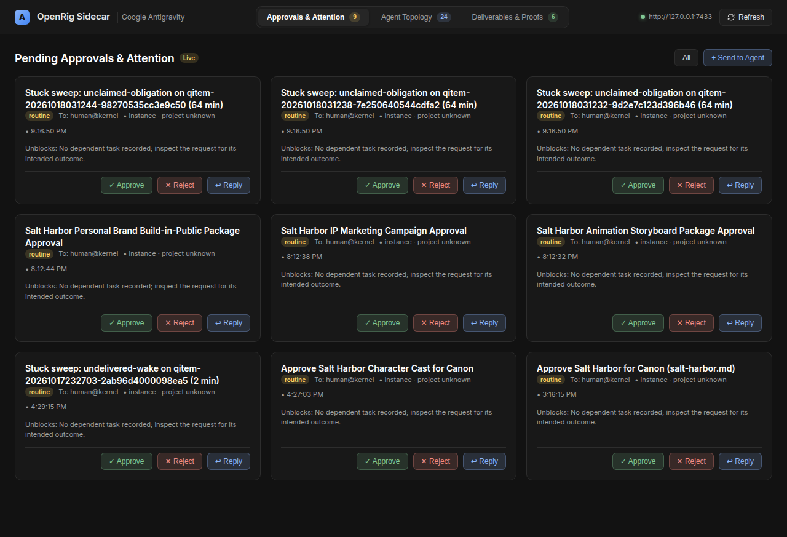
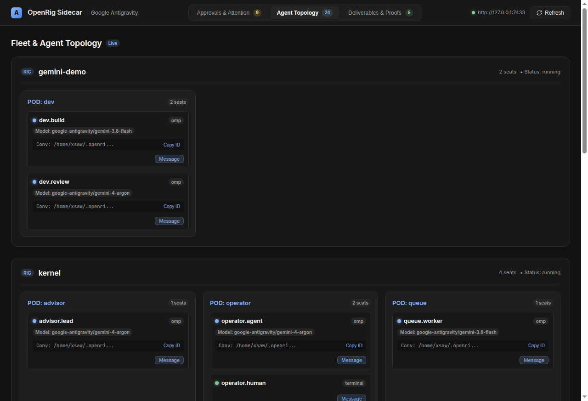
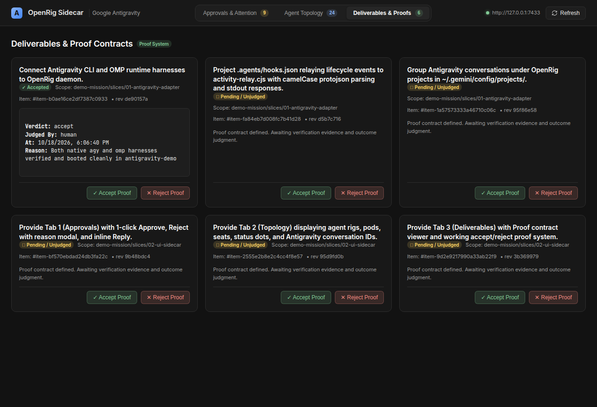

# OpenRig Sidecar

A standalone, lightweight, zero-dependency web companion and control plane for OpenRig fleets, built in the Antigravity 2.0 Obsidian aesthetic (`#121212` matte dark theme, hairline borders, no terminal ANSI clutter).

## Features

- **Tab 1: Mission Approvals & Verification**
  - Live approval status for all running rigs and missions.
  - Approve, reject, or request revisions on mission slices with a single click.
  - View full context and execution proof logs directly in the browser.

- **Tab 2: Fleet Topology & Live Matrix**
  - Complete multi-rig topology map (Kernel, Antigravity Demo, OpenRig Dev, DnD World, etc.).
  - Live seat health, runtime classification (`antigravity`, `omp`, `claude-code`, `codex`), and token burn rate.
  - Pod membership, delegation edges, and active communication links.

- **Tab 3: Deliverables & Artifacts Showcase**
  - Rich preview of generated artifacts: Markdown documents, PR diffs, images, architecture diagrams, and release packets.
  - Fast search, filter by rig or type, and one-click artifact download/export.

## Visual Tour

### Tab 1 — Mission Approvals


### Tab 2 — Fleet Topology


### Tab 3 — Deliverables


---

## Getting Started

### Prerequisites
- Node.js >= 22.0.0
- A running OpenRig daemon (default: `http://127.0.0.1:7433`)

### Installation & Build

```bash
git clone https://github.com/mvschwarz/openrig-sidecar.git
cd openrig-sidecar
npm install
npm run build
```

### Running the Sidecar

```bash
# Start on default port 7434 proxying to local OpenRig daemon
node dist/index.js

# Or with custom options
node dist/index.js --port 8080 --daemon http://127.0.0.1:7433
```

You can also launch and manage the Sidecar directly via the OpenRig CLI:

```bash
rig sidecar          # Start as a detached background daemon
rig sidecar status   # Check status and running PID
rig sidecar stop     # Stop the background process
```

---

## Architecture & Integration

- **Zero Runtime Dependencies**: Uses Node 22 native `node:http`, `URL`, and streaming proxies.
- **Embedded Single-Page UI**: Self-contained UI rendered from clean TypeScript templates without heavy bundlers.
- **Reverse Proxy**: Proxies `/api/*` requests to the OpenRig daemon (`7433`) with transparent header propagation.
- **Dual-Mount**: Can run as an independent background daemon on port `7434` or mounted directly inside the OpenRig daemon at `http://127.0.0.1:7433/sidecar`.

## License

Apache-2.0
